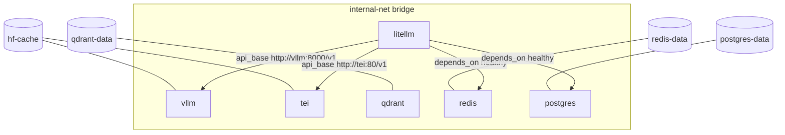
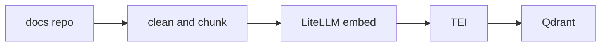
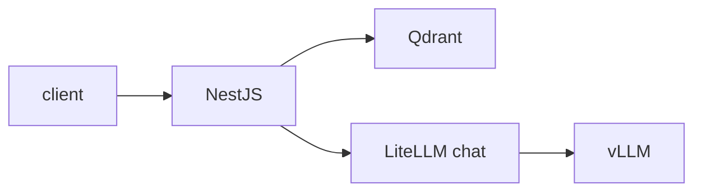

# docsage

A self-hosted assistant that answers questions about Kubernetes, Docker, and Prometheus from their official documentation. Every answer will include the source, its license, and a link to the exact page.

The stack lives in this repository. It runs from Docker Compose on a Windows 11 laptop with WSL2, an RTX 4070 Laptop (8 GB VRAM), and 16 GB RAM. The design is in [docs/design.md](docs/design.md).

## Why

A local retrieval system over the official docs, used to study for the CKA. The documents are chosen, licensed, and pinned. A local model writes the answer from the retrieved pages.

## Run

```bash
cp .env.example .env
docker compose up -d
```

`.env.example` holds placeholders only. Fill in `.env` on the machine. Do not commit it.

## Architecture

Six services are running on the Compose bridge network `internal-net`. LiteLLM is the only client entry. It exposes the names `chat` and `embed`. Ingest, the NestJS API, and the static chat UI are not built.

### Running Compose topology

- **vLLM** serves `Qwen/Qwen3-4B-AWQ` on the GPU through an OpenAI-compatible API. AWQ 4-bit weights keep the 4B model near 2.5 GB. Thinking mode is off. The host port is `127.0.0.1:8000`.
- **TEI** serves `BAAI/bge-small-en-v1.5` on the CPU. The same model embeds the chunks and the question. Vectors are 384 numbers. The host port is `127.0.0.1:8080`.
- **Qdrant** stores vectors on a named volume. REST is published on `127.0.0.1:6333`. No collection exists yet.
- **Redis** is an exact-match response cache for LiteLLM. It is not a semantic cache.
- **Postgres 18** holds LiteLLM admin UI data. The host port is `127.0.0.1:15432` because Windows has reserved 5432. Inside the network the port is still 5432.
- **LiteLLM** is the gateway in front of vLLM and TEI. Callers use `chat` and `embed`. The host port is `127.0.0.1:4000`.



### Ingest

Not built. The job clones each docs repo at a pinned tag, cleans the Markdown, splits each page into chunks by heading, embeds through LiteLLM, and stores the vectors in Qdrant. A second run does not create duplicates.



### Ask

Not built. NestJS exposes `POST /ask` and `GET /health`. `/ask` embeds the question, searches Qdrant, and asks the model to answer only from those chunks. The static chat page calls `/ask` and shows the answer and its sources.



## Data

Ingestion uses a shallow clone pinned to a tag or commit, so each index names the exact docs version.

| Source | Docs | Repository | Path | License |
|---|---|---|---|---|
| Kubernetes | [kubernetes.io/docs](https://kubernetes.io/docs/) | [kubernetes/website](https://github.com/kubernetes/website) | `content/en/docs` | [CC BY 4.0](https://creativecommons.org/licenses/by/4.0/) |
| Docker | [docs.docker.com](https://docs.docker.com/) | [docker/docs](https://github.com/docker/docs) | `content/` | [Apache 2.0](https://www.apache.org/licenses/LICENSE-2.0) |
| Prometheus | [prometheus.io/docs](https://prometheus.io/docs/) | [prometheus/docs](https://github.com/prometheus/docs), [prometheus/prometheus](https://github.com/prometheus/prometheus) | `content/docs`, `docs/` | [Apache 2.0](https://www.apache.org/licenses/LICENSE-2.0) |

## Status

The Compose stack is running: vLLM, TEI, Qdrant, Redis, Postgres, and LiteLLM. Ingest, the NestJS `POST /ask` and `GET /health` API, and the static chat UI are not built. Qdrant has no collection yet.

## License

Code in this repository is [MIT](LICENSE). The indexed documentation stays under the licenses in the table above. `Qwen/Qwen3-4B-AWQ` is [Apache 2.0](https://www.apache.org/licenses/LICENSE-2.0), and `BAAI/bge-small-en-v1.5` is [MIT](https://huggingface.co/BAAI/bge-small-en-v1.5). Both download at runtime, so this MIT license does not cover them.
