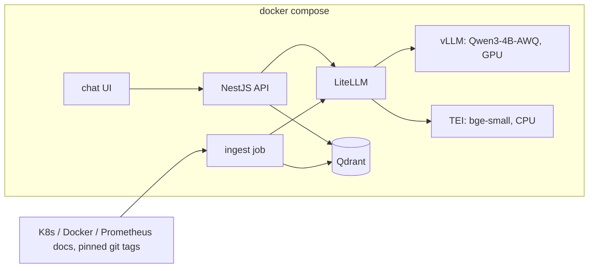

# docsage

A self-hosted assistant that answers questions about Kubernetes, Docker, and Prometheus from their official documentation. Every answer will include the source, its license, and a link to the exact page.

The stack will live in this repository and will start with `docker compose up` on a laptop: WSL2 and an NVIDIA GPU with 8 GB or more.

## Why

A local retrieval system over the official docs, used to study for the CKA. The documents are chosen, licensed, and pinned. A local model writes the answer from the retrieved pages.

## Architecture

- **Ingest** clones each docs repo at a pinned tag, cleans the Markdown, splits each page into chunks by heading, and stores the vectors plus metadata in Qdrant. A second run does not create duplicates.
- **TEI** serves `BAAI/bge-small-en-v1.5` on the CPU. The same model embeds the chunks and the question. Vectors are 384 numbers.
- **Qdrant** returns the nearest chunks and can filter by source, for example Kubernetes only. The index sits on a Docker volume.
- **vLLM** serves `Qwen/Qwen3-4B-AWQ` on the GPU through an OpenAI-compatible API. AWQ 4-bit weights keep the 4B model near 2.5 GB. Thinking mode is off, so an answer is the reply itself.
- **LiteLLM** is the single gateway in front of vLLM and TEI. The API calls names like `chat` and `embed`.
- **API** (NestJS) exposes `POST /ask` and `GET /health`. `/ask` embeds the question, searches Qdrant, and asks the model to answer only from those chunks.
- **Chat UI** is a static page that calls `/ask` and shows the answer and its sources.

## Data

Ingestion uses a shallow clone pinned to a tag or commit, so each index names the exact docs version.

| Source | Docs | Repository | Path | License |
|---|---|---|---|---|
| Kubernetes | [kubernetes.io/docs](https://kubernetes.io/docs/) | [kubernetes/website](https://github.com/kubernetes/website) | `content/en/docs` | [CC BY 4.0](https://creativecommons.org/licenses/by/4.0/) |
| Docker | [docs.docker.com](https://docs.docker.com/) | [docker/docs](https://github.com/docker/docs) | `content/` | [Apache 2.0](https://www.apache.org/licenses/LICENSE-2.0) |
| Prometheus | [prometheus.io/docs](https://prometheus.io/docs/) | [prometheus/docs](https://github.com/prometheus/docs), [prometheus/prometheus](https://github.com/prometheus/prometheus) | `content/docs`, `docs/` | [Apache 2.0](https://www.apache.org/licenses/LICENSE-2.0) |

## Status

Foundation. The MIT license is in place. Compose (vLLM, then TEI and LiteLLM), ingestion, and the API come next. Quickstart and configuration land with the first runnable stack.

## License

Code in this repository is [MIT](LICENSE). The indexed documentation stays under the licenses in the table above. `Qwen/Qwen3-4B-AWQ` is [Apache 2.0](https://www.apache.org/licenses/LICENSE-2.0), and `BAAI/bge-small-en-v1.5` is [MIT](https://huggingface.co/BAAI/bge-small-en-v1.5). Both download at runtime, so this MIT license does not cover them.
